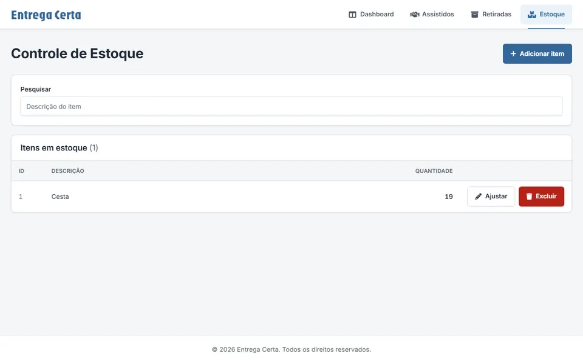

# Entrega Certa Web (v1)

Angular frontend for the first version of **Entrega Certa**, a system that helps a non-profit manage food basket donations: beneficiaries, pickups and inventory.



> **This is version 1.** The project evolved into a full rewrite with authentication, permissions and a much larger domain:
> **[Web app v2](https://github.com/gabrielmdss/pastoral_fronted)** · **[API v2](https://github.com/gabrielmdss/entrega_certa_backend_v3)**

**Live demo:** [entregacerta-frontend.onrender.com](https://entregacerta-frontend.onrender.com/estoque) · **API (v1):** [gabrielmdss/entregaCerta-backend](https://github.com/gabrielmdss/entregaCerta-backend)

> Hosted on Render's free tier: the first load may take up to a minute. The demo contains only fictional data.

## Features

- **Dashboard** with pickup charts per month (Chart.js) and cards you can **reorder with drag and drop**; the order is saved in the browser.
- **Beneficiaries**: registration with document photo upload, document input mask and formatting.
- **Pickups**: history with filters and pagination.
- **Inventory**: stock list with search, adjustments and highlight for items out of stock.

## Tech stack

| Area | Tools |
|---|---|
| Framework | Angular 19 (standalone components, lazy-loaded routes) |
| UI | Angular CDK drag and drop, Chart.js via ng2-charts, ng-select, SweetAlert2, Font Awesome |
| Quality | Jasmine/Karma specs |
| Deploy | Express static server on Render |

## Getting started

```bash
npm install
npm start
```

The API URL is configured in `src/environments/environment.ts` (development) and `environment.prod.ts` (production). Run the [v1 API](https://github.com/gabrielmdss/entregaCerta-backend) locally on the port set there.

| Script | What it does |
|---|---|
| `npm start` | Dev server at `http://localhost:4200` |
| `npm run build` | Production build |
| `npm test` | Unit tests |
| `node server.js` | Serve the production build (used on Render) |

## Author

**Gabriel Mendes**, Full Stack Developer · [Portfolio](https://gabriel-mendes-dev.vercel.app) · [LinkedIn](https://linkedin.com/in/gabrielmendesdeveloper)
